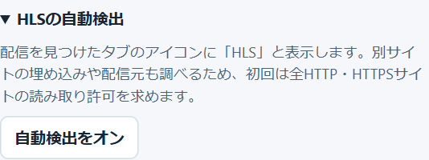
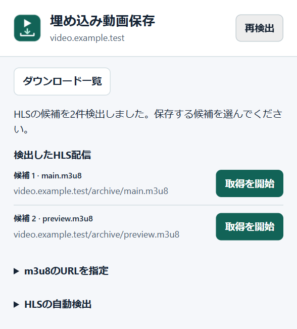
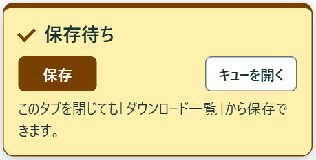
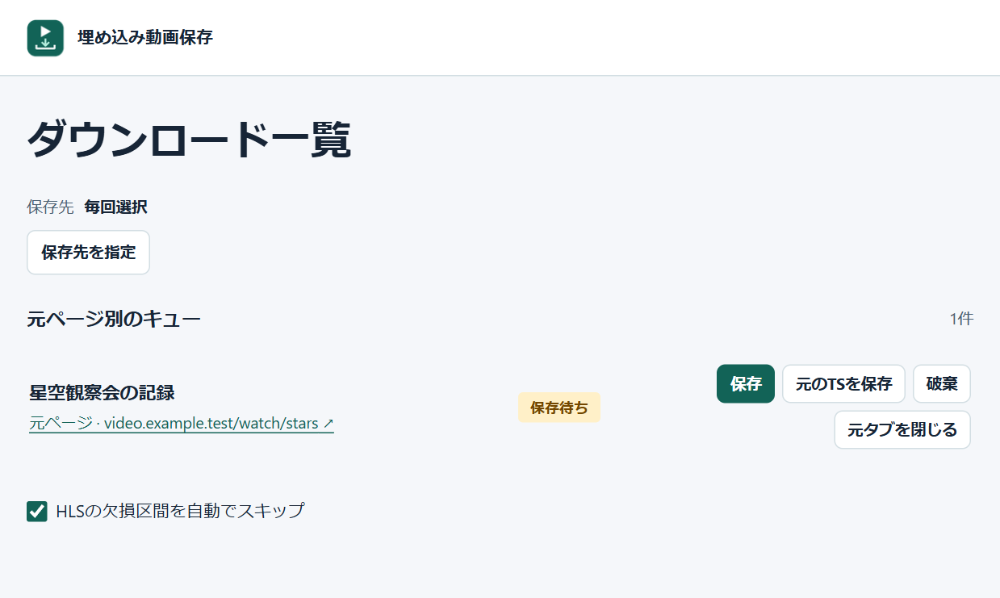

# 埋め込み動画保存

Webページに埋め込まれた動画を、パソコンの好きなフォルダーに保存するGoogle Chrome拡張機能です。録画済みのHLS配信なら、動画を最後まで再生せずにMP4として保存できます。保存先を一度登録すれば、次からは取得を始めるだけでファイルが保存されます。

## Chromeに追加する

1. 配布用ZIPを、使い続けるフォルダーに展開します。
2. デスクトップ版Chrome（109以降）で `chrome://extensions` を開き、右上の **デベロッパー モード** をオンにします。
3. **パッケージ化されていない拡張機能を読み込む** を押し、展開先にある **`extension` フォルダー** を選びます。
4. ツールバーのパズル型アイコンを開き、**埋め込み動画保存** を固定します。

## 最初の設定

**配信を自動で見つける**  
通常のWebページで拡張アイコンを開き、**HLSの自動検出 → 自動検出をオン** を押します。Chromeの確認画面でサイトの読み取りを許可し、すでに開いていた動画ページは再読み込みします。自動検出はオンのまま使えます。

**保存先を決める**  
拡張の **ダウンロード一覧 → 保存先を指定** でフォルダーを選び、Chromeに書き込みを許可します。保存先は3か所まで登録でき、一覧でフォルダー名を押すと切り替わります。動画ごとに保存場所を決めたい場合は **毎回選ぶ** を使えます。

## 動画を保存する

1. **動画ページで拡張アイコンを押します。** 赤い「HLS」が配信を見つけた目印です。候補が1件ならそのまま取得が始まります。複数あるときは、保存したい配信の **取得を開始** を押します。候補が出なければ、動画を少し再生してから **再検出** を押します。
2. **元ページの右上で進み具合を確認します。** 「取得中」は配信元から動画を読み込んでいる段階、「保存中」は動画ファイルをストレージに書き込んでいる段階です。元タブを開いておく必要がある配信では、パネルに案内が出ます。
3. **「保存済み」と出たら完了です。** 保存先を登録していれば自動で完了します。「保存待ち」と出た場合は、元ページか **ダウンロード一覧** の **保存** を押します。「保存待ち」になった動画は、同じChromeセッションなら元タブを閉じたあとも一覧から保存できます。Chromeの終了や拡張の更新前に、残したい動画を保存してください。

**配信を選ぶ画面**  
サンプルページで本編と予告編の2件を検出した例です。

**元ページで保存する**  
保存先を毎回選ぶ場合は、動画ページ右上のパネルで操作できます。

**一覧から保存する**  
元ページのリンク、動画ごとの進捗、保存ボタンを確認できます。下の例では「星空観察会の記録」が保存待ちです。

## 保存できる動画

| 動画の種類 | 操作と保存内容 |
| --- | --- |
| 録画済みのHLS配信（m3u8） | 公開されている区間を取得してMP4にまとめます。対応形式なら、別々に配信される映像と音声も1本になります。 |
| HLSのライブ配信 | 開始時点で配信元に残っている区間から取得します。**取得を停止** を押すと、そこまでの分を保存できます。 |
| ページ上のMP4・WebMなど | **ファイルを保存** の候補から **ダウンロード** を押すと、元のファイル形式で保存します。 |
| 再生した部分だけ録画 | **キャプチャモード → キャプチャを開く** から録画を開始し、残したい区間を再生します。 |

HLSの取得対象は暗号化されていない配信です。DRM保護のある動画は保存できません。一部の区間を取得できず **欠損あり** と出た動画は、その区間を除いた内容になります。

### Windowsで対応サイトの動画を丸ごと保存する

64ビット版Windowsでは、YouTube、ニコニコ動画、Dailymotion、Vimeoの公開済み動画が **丸ごと保存** の候補になります。初回だけ、展開先の `Windows-Setup.cmd` を実行します。セットアップは保存用のツールをダウンロードし、そのWindowsユーザーに登録します。

対応する動画ページで拡張アイコンを押し、候補が表示されたら **丸ごと保存** を選びます。初回はキューの **許可して取得** でPCツールとの接続を許可します。完了までキューを開いておいてください。配信元の公開条件によって取得できる動画は異なります。

## 利用条件

自分の端末で使用できます。本ソフトウェアの再配布・転載・販売は、改変の有無や有償・無償を問わず禁止します。第三者製のライブラリやツールには各提供元のライセンスが適用されます。保存する動画は、ご自身が保存する権利または許可を持つものを対象にしてください。[利用条件の全文](LICENSE.md)
